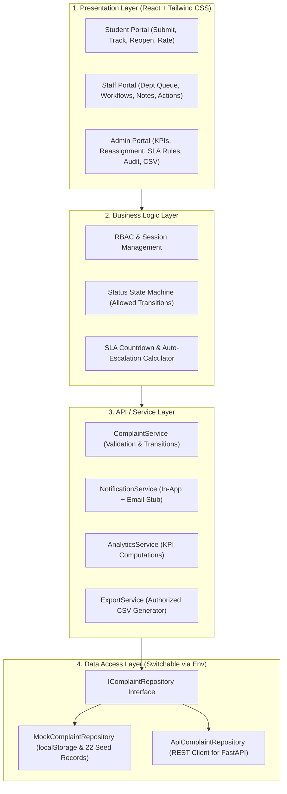
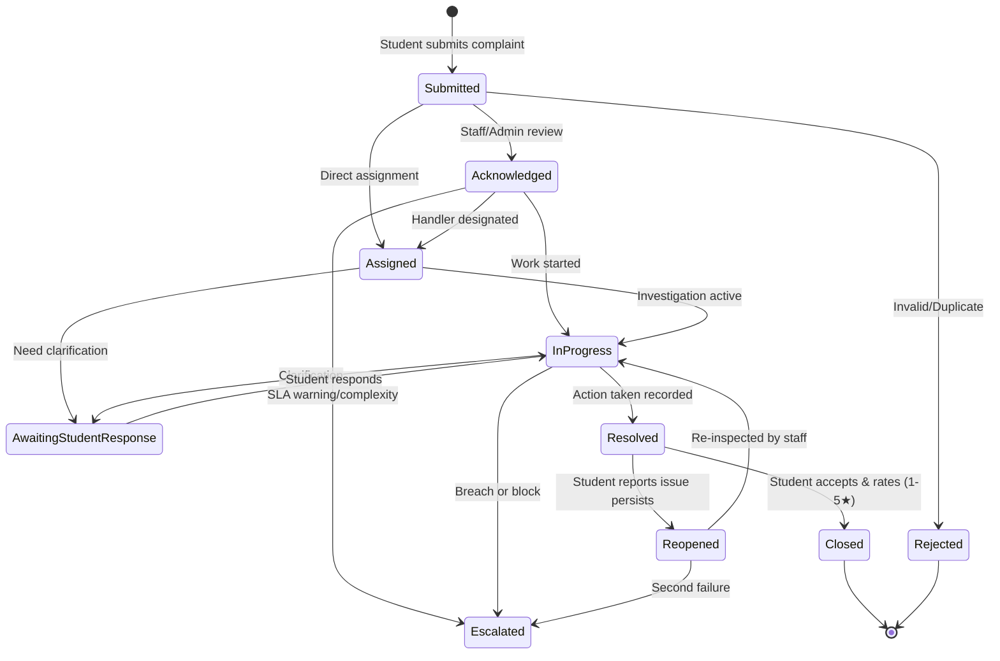

# College Complaint Management System (CCMS)

A complete, modern, responsive, and functional **College Complaint Management System (CCMS)** prototype engineered for collegiate environments. Built with **React 19**, **TypeScript**, **Tailwind CSS**, **Lucide Icons**, **React Router 7**, and **Recharts**, designed with a decoupled **Data Access Layer** ready for immediate **PostgreSQL / FastAPI** backend integration.

---

## 1. Quick Start & Setup Instructions

### Prerequisites
- **Node.js**: v18+ (tested on v24.19.0)
- **npm**: v9+ (tested on v12.2.0)

### Installation & Launch Commands
```bash
# Navigate to the project directory
cd college-complaint-system

# Install dependencies
npm install

# Start development server
npm run dev
```
Open **[http://localhost:5173](http://localhost:5173)** in your browser to access the portal.

### Run Automated Unit & Integration Tests
```bash
npm run test
```

### Production Build
```bash
npm run build
```

---

## 2. Documented Demo Accounts & 1-Click Role Switcher

The application includes an **in-navbar 1-click Role Switcher** and pre-seeded demonstration accounts so you can seamlessly test and evaluate all user journeys:

| Role | Demo User Name | Demo Email | Roll No / Department | Key Capabilities |
| :--- | :--- | :--- | :--- | :--- |
| **Student** | **Rahul Sharma** | `rahul.sharma@college.edu` | `ENG-2024-CSE-042` | Submit tickets, track live timelines, post comments, reopen resolved tickets, submit 1–5★ feedback. |
| **Staff (IT)** | **Vikram Verma** | `it.staff@college.edu` | IT Services & Network Infrastructure | Manage department queue, acknowledge tickets, add internal notes, record resolution actions taken. |
| **Staff (Maint)** | **Ramesh Chander** | `maint.staff@college.edu` | Campus Works & Estate Maintenance | Manage civil/electrical repairs, update progress, escalate tickets. |
| **Admin** | **Prof. David Miller** | `admin@college.edu` | Dean / College Administrator | View all 22+ complaints, SLA compliance analytics, reassign handlers, adjust priority, audit logs, CSV export. |

> **Pro Tip**: You can also use the **"Reset Seed Data"** button anytime from the Navbar or Admin Settings to restore the database to the clean initial 22 demonstration complaints.

---

## 3. System Architecture & Database-Ready Design

The application is structured into four cleanly isolated layers to ensure that a real PostgreSQL/FastAPI backend can be integrated with zero frontend rewrites:



### Configurable Data Provider (`VITE_DATA_PROVIDER`)
Configure provider mode in `.env`:
```env
# 'mock' uses local storage with 22 seed records; 'api' connects to real backend
VITE_DATA_PROVIDER=mock
VITE_API_BASE_URL=http://localhost:8000/api/v1
```

---

## 4. Complaint Lifecycle State Machine

Status transitions are governed by centralized business logic (`ALLOWED_TRANSITIONS` in `src/data/constants.ts`):



---

## 5. Complaint Categories (Engineering College)

1. **Infrastructure and Maintenance**: Classroom maintenance, electrical issues, water supply & plumbing, furniture damage, lab equipment, building repair.
2. **IT and Technical Issues**: Campus Wi-Fi, computer labs, college portal, student accounts, smart classroom projectors.
3. **Academic Issues**: Timetable discrepancies, examination schedules, attendance rectifications, faculty concerns.
4. **Administration**: Documentation, bona fide certificates, fee refund queries, delays.
5. **Library**: Book availability, digital IEEE/ACM journal access, reading hall AC.
6. **Hostel and Campus Facilities**: Room upkeep, mess food hygiene, drinking water coolers, washrooms.
7. **Transportation**: College bus schedules, route extensions, overcrowding.
8. **Safety and Security (Confidential)**: Unsafe campus conditions, pathway lighting, confidential harassment/misconduct.
9. **Other**: General cafeteria and campus inquiries.

---

## 6. PostgreSQL Relational Database Schema

The production-ready PostgreSQL relational database schema is documented and located at:
`src/database/schema.sql`

Includes:
- Tables: `roles`, `departments`, `users`, `complaint_categories`, `complaint_subcategories`, `complaints`, `complaint_attachments`, `complaint_comments`, `complaint_status_history`, `complaint_feedback`, `escalation_rules`, `notifications`, `audit_logs`.
- Foreign keys, ENUM types (`complaint_status_enum`, `complaint_priority_enum`), indexes, and audit triggers.

---

## 7. Connecting to a FastAPI / Python Backend

To connect the frontend to a real FastAPI backend:
1. Initialize FastAPI with SQLAlchemy models matching `src/database/schema.sql`.
2. Update `.env`:
   ```env
   VITE_DATA_PROVIDER=api
   VITE_API_BASE_URL=http://localhost:8000/api/v1
   ```
3. Restart `npm run dev`. The `ApiComplaintRepository` will automatically route all data requests to your FastAPI REST endpoints.
