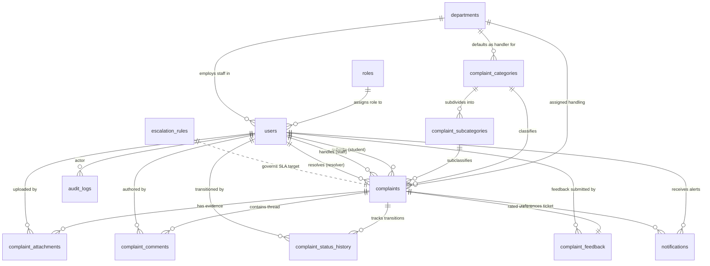

# CCMS Database Documentation (MySQL 8.0)

A comprehensive guide to the **College Complaint Management System (CCMS)** relational database schema, converted and optimized for **MySQL 8.0+** and **InnoDB**.

---

## 1. Quick Start & Execution Guide

### Prerequisites
- **MySQL Server 8.0.16+** (tested on MySQL Community Server 8.0.46)
- **MySQL Workbench 8.0+** (or MySQL CLI / PowerShell)
- Administrative or database user privileges (`CREATE DATABASE`, `CREATE TABLE`, `CREATE TRIGGER`)

---

### Option A: Running in MySQL Workbench (Recommended for Beginners)

1. **Open MySQL Workbench** and connect to your local MySQL instance (e.g., `Local instance MySQL80` as user `root`).
2. Go to **File** → **Open SQL Script...** (or press `Ctrl + Shift + O`).
3. Select and open:
   ```
   backend/database/schema.mysql.sql
   ```
4. Click the **Execute** button (the yellow lightning bolt icon ⚡) or press `Ctrl + Shift + Enter`.
5. Look at the **Action Output** pane at the bottom:
   - All table creation, trigger registration, and seed insertion statements should display green checkmarks.
6. In the left **Navigator** pane, under the **Schemas** tab, right-click and select **Refresh All**.
7. Expand `ccms_db` → `Tables` to verify that all 13 relational tables are listed.

---

### Option B: Running via Windows PowerShell / Command Prompt

Open PowerShell in the project root and run:

```powershell
# Using the full path to MySQL 8.0 if not in system PATH
& "C:\Program Files\MySQL\MySQL Server 8.0\bin\mysql.exe" -u root -p < "backend\database\schema.mysql.sql"
```

Enter your MySQL root password when prompted. The script will automatically create `ccms_db`, construct all tables, attach triggers, and populate the seed records.

---

## 2. Table Catalog (Data Dictionary)

The database consists of **13 relational tables** covering all functional facets of collegiate grievance logging, assignment, SLA enforcement, and communication.

| # | Table Name | Purpose & Contents | Primary Key | Foreign Keys |
|---|---|---|---|---|
| 1 | `roles` | Reference table defining access roles (`student`, `staff`, `admin`). | `id` (VARCHAR 32) | *None* |
| 2 | `departments` | Campus academic, administrative, and maintenance divisions (e.g., IT, Maintenance, Hostel, Proctorial Board). | `id` (VARCHAR 36) | *None* |
| 3 | `users` | User accounts for students, department technicians/staff, and administrators. Stores hashed passwords, role links, and optional student roll numbers or department links. | `id` (VARCHAR 36) | `role_id` → `roles(id)`<br>`department_id` → `departments(id)` |
| 4 | `complaint_categories` | Top-level grievance categories (e.g., Infrastructure, IT, Academics, Safety). Links to a default resolving department. | `id` (VARCHAR 36) | `default_department_id` → `departments(id)` |
| 5 | `complaint_subcategories` | Granular sub-issues under each category (e.g., Wi-Fi, Water Supply, Broken Furniture). | `id` (VARCHAR 36) | `category_id` → `complaint_categories(id)` |
| 6 | `escalation_rules` | Service Level Agreement (SLA) target hours for acknowledgement, resolution, and escalation per priority level. | `id` (VARCHAR 36) | *None* |
| 7 | `complaints` | Core grievance records. Contains title, description, category/subcategory, location (campus area, building, floor, room), priority, lifecycle status, SLA deadline, and resolution details. | `id` (VARCHAR 32, e.g. `CCMS-2026-1001`) | `category_id` → `complaint_categories(id)`<br>`subcategory_id` → `complaint_subcategories(id)`<br>`department_id` → `departments(id)`<br>`student_id` → `users(id)`<br>`assigned_staff_id` → `users(id)`<br>`resolved_by_id` → `users(id)` |
| 8 | `complaint_attachments` | Uploaded supporting evidence (images, documents, error logs) with file size, MIME type, and storage URI. | `id` (VARCHAR 36) | `complaint_id` → `complaints(id)`<br>`uploaded_by` → `users(id)` |
| 9 | `complaint_comments` | Chronological communication thread between students and staff, supporting staff-only internal notes (`is_internal = TRUE`). | `id` (VARCHAR 36) | `complaint_id` → `complaints(id)`<br>`user_id` → `users(id)` |
| 10 | `complaint_status_history` | Immutable state transition audit trail logging `from_status` → `to_status`, timestamp, actor, and mandatory remarks. | `id` (VARCHAR 36) | `complaint_id` → `complaints(id)`<br>`changed_by_id` → `users(id)` |
| 11 | `complaint_feedback` | Post-resolution student satisfaction rating (1 to 5 stars) and optional feedback comments. | `id` (VARCHAR 36) | `complaint_id` → `complaints(id)`<br>`student_id` → `users(id)` |
| 12 | `notifications` | In-app user alerts dispatched upon status updates, technician reassignments, SLA warnings, and comment posts. | `id` (VARCHAR 36) | `user_id` → `users(id)`<br>`complaint_id` → `complaints(id)` |
| 13 | `audit_logs` | Immutable security log capturing administrative actions, configuration modifications, and system events with JSON details. | `id` (VARCHAR 36) | `user_id` → `users(id)` |

---

## 3. Relationships & Referential Integrity



### Referential Integrity Action Rules:
- **`ON DELETE CASCADE`**:
  - `complaint_subcategories` deleted when parent category is deleted.
  - `complaint_attachments`, `complaint_comments`, `complaint_status_history`, and `complaint_feedback` are automatically cleaned up when the parent `complaints` record is deleted.
  - `notifications` are removed if the recipient `users` account is removed.
- **`ON DELETE SET NULL`**:
  - `users.department_id` becomes `NULL` if a department is deleted (preserves user account).
  - `complaint_categories.default_department_id` becomes `NULL` if department is deleted.
  - `complaints.subcategory_id`, `complaints.assigned_staff_id`, and `complaints.resolved_by_id` are set to `NULL` if the associated record is deleted.
  - `notifications.complaint_id` and `audit_logs.user_id` become `NULL` to preserve historical logs.
- **`ON UPDATE CASCADE`**:
  - All foreign key primary key updates automatically propagate across all child records.

---

## 4. PostgreSQL to MySQL 8.0 Conversion Analysis

| Feature | Original PostgreSQL Schema | Converted MySQL 8.0 Schema | Rationale & Technical Details |
|---|---|---|---|
| **UUID Generation** | `id UUID DEFAULT uuid_generate_v4()` via extension `"uuid-ossp"` | `id VARCHAR(36) NOT NULL` + `BEFORE INSERT` Trigger setting `IF NEW.id IS NULL OR NEW.id = '' THEN SET NEW.id = UUID(); END IF;` | **Critical MySQL 8 Limitation**: In MySQL 8.0, non-deterministic functions like `UUID()` are **strictly forbidden** inside column `DEFAULT (...)` expressions (raises `ERROR 3770 (HY000)`). Using `BEFORE INSERT` triggers provides 100% equivalent behavior: omitting `id` generates a valid RFC 4122 UUID, while explicitly providing an ID (e.g., `'dept-it'`, `'user-student-1'`) is preserved. |
| **ENUM Types** | Global custom types created via `CREATE TYPE ... AS ENUM (...)` | Inline column-level `ENUM('val1', 'val2', ...)` | MySQL does not support standalone `CREATE TYPE ... AS ENUM` statements. ENUM options are declared inline on `status`, `priority`, and history tables. |
| **Automatic Timestamps** | `TIMESTAMP WITH TIME ZONE` + PL/pgSQL function & `BEFORE UPDATE` procedural triggers | `DATETIME NOT NULL DEFAULT CURRENT_TIMESTAMP ON UPDATE CURRENT_TIMESTAMP` | MySQL's InnoDB engine supports native hardware-accelerated auto-updating timestamps (`ON UPDATE CURRENT_TIMESTAMP`). This avoids procedural overhead and triggers for timestamp maintenance. |
| **Timezone Storage** | `TIMESTAMP WITH TIME ZONE` | `DATETIME` | MySQL's `TIMESTAMP` has a 2038 epoch constraint (32-bit signed integer). `DATETIME` supports dates through year 9999 without epoch truncation and stores ISO-8601 compliant timestamps. |
| **Boolean Types** | `BOOLEAN DEFAULT TRUE` | `BOOLEAN NOT NULL DEFAULT TRUE` (mapped to `TINYINT(1)`) | In MySQL, `BOOLEAN` is an alias for `TINYINT(1)`, where `1 = TRUE` and `0 = FALSE`. Queries using `WHERE is_active = TRUE` or `WHERE is_active = 1` work identically. |
| **JSON Storage** | `JSONB` | Native `JSON` | PostgreSQL `JSONB` stores decomposed binary JSON. MySQL 8 has built-in native `JSON` column support with automatic syntax validation and optimized binary storage. |
| **Check Constraints** | `CHECK (rating >= 1 AND rating <= 5)` | `CONSTRAINT chk_feedback_rating CHECK (rating >= 1 AND rating <= 5)` | MySQL 8.0.16+ fully enforces table `CHECK` constraints (unlike MySQL 5.7 which accepted the syntax but silently ignored enforcement). |
| **Idempotent Inserts** | `INSERT INTO ... ON CONFLICT (id) DO NOTHING` | `INSERT IGNORE INTO ...` | `INSERT IGNORE` is MySQL's standard SQL dialect for skipping insertion on primary/unique key conflicts, allowing the script to be run multiple times safely. |
| **Engine & Collation** | Postgres default heap/MVCC | `ENGINE=InnoDB DEFAULT CHARSET=utf8mb4 COLLATE=utf8mb4_unicode_ci` | Explicitly targets `InnoDB` for full ACID transactions, row-level locking, foreign keys, and `utf8mb4` to support multi-language text and emojis. |

---

## 5. Seed Data Included

The MySQL script includes complete, non-conflicting seed records matching the application's initial demo environment:

1. **3 Roles**: `student`, `staff`, `admin`.
2. **8 Departments**: `dept-it`, `dept-maint`, `dept-acad`, `dept-admin`, `dept-lib`, `dept-hostel`, `dept-trans`, `dept-sec`.
3. **9 Categories**: Infrastructure, IT, Academics, Administration, Library, Hostel, Transportation, Safety & Security, Other.
4. **40 Subcategories**: Detailed issue classifications for each category.
5. **4 SLA Rules**: Priority target hours for `critical`, `high`, `medium`, and `low`.
6. **7 Demonstration Users**:
   - `admin@college.edu` (Prof. David Miller - Dean/Admin)
   - `it.staff@college.edu` (Vikram Verma - IT Staff)
   - `maint.staff@college.edu` (Ramesh Chander - Maintenance Lead)
   - `hostel.staff@college.edu` (Sunita Deshmukh - Hostel Warden)
   - `rahul.sharma@college.edu` (Rahul Sharma - Student, CSE)
   - `priya.patel@college.edu` (Priya Patel - Student, ECE)
   - `aditya.sen@college.edu` (Aditya Sen - Student, MECH)
7. **Demonstration Ticket & Audit Trail**:
   - Complaint `CCMS-2026-1001` (Wi-Fi outage in Turing Lab 3) with full status history and comments.

---

## 6. Verification Queries

After executing the script in MySQL Workbench, you can run the following test queries to verify setup:

```sql
USE ccms_db;

-- 1. Verify all 13 tables exist
SHOW TABLES;

-- 2. Verify row counts in seeded master tables
SELECT 'roles' AS table_name, COUNT(*) AS count FROM roles
UNION ALL
SELECT 'departments', COUNT(*) FROM departments
UNION ALL
SELECT 'complaint_categories', COUNT(*) FROM complaint_categories
UNION ALL
SELECT 'complaint_subcategories', COUNT(*) FROM complaint_subcategories
UNION ALL
SELECT 'escalation_rules', COUNT(*) FROM escalation_rules
UNION ALL
SELECT 'users', COUNT(*) FROM users
UNION ALL
SELECT 'complaints', COUNT(*) FROM complaints;

-- 3. Test automatic UUID trigger on insert
INSERT INTO departments (code, name, contact_email) 
VALUES ('DEPT-CHEM', 'Department of Chemical Engineering', 'chem@college.edu');

-- Check that an RFC 4122 UUID was automatically assigned
SELECT id, code, name, created_at FROM departments WHERE code = 'DEPT-CHEM';

-- 4. Clean up test record
DELETE FROM departments WHERE code = 'DEPT-CHEM';
```

---

## 7. Assumptions & Technical Notes

1. **ID Length & Format**: Primary key columns default to `VARCHAR(36)` instead of `CHAR(36)` to support both 36-character standard UUID strings (e.g. `c73bcdcc-3524-40f1-a5f1-6beb8dddd001`) and readable test identifiers (e.g. `dept-it`, `user-student-1`) without padding spaces.
2. **Password Hashes**: User passwords in the seed records are stored as bcrypt hashes (`$2b$12$...`) of `'password123'`. When integrating the FastAPI/Python backend, utilize `passlib` or `bcrypt` for password verification.
3. **No Frontend Impact**: The original React frontend and `src/database/schema.sql` remain completely intact. The new MySQL schema is isolated under `backend/database/`.
